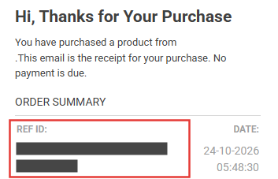
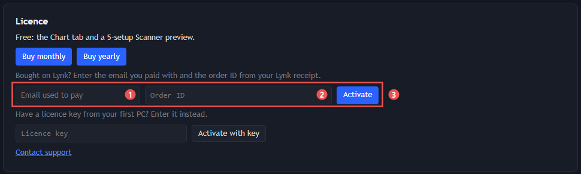

# Cara mengaktifkan Chartwizard Pro

Aktivasi cukup memakai **email yang kamu pakai untuk membayar** dan **Order ID dari struk Lynk.id**. Kamu tidak perlu
menunggu email lisensi. [English version below](#english).

## 1. Beli Pro

Beli di Lynk.id: [bulanan](https://lynk.id/codewizard/0j4z82e188gn) atau [tahunan](https://lynk.id/codewizard/jr2qg5k48m85).
Kamu juga bisa membukanya dari app lewat **Settings → Licence → Buy monthly / Buy yearly**.

## 2. Cari Order ID di struk Lynk.id

Setelah membayar, Lynk.id mengirim email struk berjudul **"Hi, Thanks for Your Purchase"**. Di bagian
**ORDER SUMMARY**, kode di bawah **REF ID** adalah Order ID kamu.

- Order ID terdiri dari **32 karakter** (huruf a–f dan angka). Di email kodenya terpotong jadi dua baris, tapi itu satu
  kode: salin semuanya **tanpa spasi**.
- Order ID di gambar sengaja disensor. Pakai kode dari struk kamu sendiri.
- **Jangan bagikan Order ID kamu.** Bersama email kamu, kode ini bisa dipakai untuk mengaktifkan lisensimu.

## 3. Aktifkan di Chartwizard

1. Buka Chartwizard, lalu tab **Settings**. Bagian **Licence** ada di paling atas.
2. Isi tiga hal ini:

   

   1. **Email used to pay**: email yang kamu pakai saat membayar di Lynk.id.
   2. **Order ID**: REF ID dari struk.
   3. Pilih **Activate**.
3. Jika berhasil, baris status berubah menjadi **Pro (yearly) until …** atau **Pro (monthly) until …**, dan tab
   **Screener** serta **Sectors** terbuka.
4. **Licence key** kamu (`IDXC-…`) sekarang tampil di bagian ini. Pilih **Copy** dan simpan; key ini berguna untuk PC
   kedua.

Baru saja membayar? Tunggu sekitar satu menit sebelum menekan **Activate**, karena pembayaran perlu sampai ke server
lisensi dulu.

## PC kedua

Satu lisensi berlaku untuk **2 PC**. Di PC kedua, isi email dan Order ID yang sama lalu pilih **Activate**. Bisa juga
dengan menempelkan licence key di kolom **Licence key** lalu memilih **Activate with key**.

## Ganti PC (PC ketiga)

Jika kedua slot sudah terpakai, app menampilkan pesan *This licence is active on 2 PCs. Release one to use it here.* dan
daftar PC kamu, lengkap dengan kapan terakhir terlihat (**last seen**). Pilih **Release** pada PC yang sudah tidak
dipakai, dan PC ini langsung aktif menggantikannya.

## Perpanjang

Beli lagi dengan **email yang sama**, lalu buka **Settings → Licence** dan pilih **Refresh**. Tanggal **until** akan
bertambah. Kamu tidak perlu aktivasi ulang.

## Install ulang atau Windows baru

Aktifkan lagi dengan email dan Order ID yang sama. Selama PC-nya sama, PC itu tidak memakai slot baru.

## Jika muncul pesan error

| Pesan di app | Artinya dan yang perlu dilakukan |
|---|---|
| *No paid order matches that email and order ID…* | Email atau Order ID tidak cocok. Pastikan emailnya sama persis dengan yang dipakai saat membayar, dan Order ID disalin utuh tanpa spasi. Jika baru membayar, tunggu satu menit lalu coba lagi. |
| *This licence is active on 2 PCs. Release one to use it here.* | Kedua slot sudah terpakai. Lihat [Ganti PC](#ganti-pc-pc-ketiga). |
| *Too many attempts. Wait a few minutes and try again.* | Terlalu banyak percobaan. Tunggu beberapa menit. |
| *Can't reach the licence server…* | Periksa koneksi internet, lalu coba lagi. |
| *This licence has been cancelled. Contact support.* | Hubungi support. |

Masih bermasalah? Pilih **Contact support** di **Settings → Licence**.

---

## English

1. **Buy Pro** on Lynk.id: [monthly](https://lynk.id/codewizard/0j4z82e188gn) or
   [yearly](https://lynk.id/codewizard/jr2qg5k48m85).
2. **Find your order ID.** Lynk.id emails you a receipt, "Hi, Thanks for Your Purchase". The code under **REF ID** in
   the **ORDER SUMMARY** is your order ID: 32 letters and digits, wrapped over two lines but one code. Copy all of it
   without spaces, and keep it private.
3. **Activate.** In Chartwizard, open **Settings → Licence**, enter the **Email used to pay** and the **Order ID**, and
   choose **Activate**. If you've just paid, wait a minute first.
4. The status line then reads **Pro (…) until …**, and the Screener and Sectors tabs unlock. Choose **Copy** next to
   your **Licence key** and keep it.

- **Second PC:** one licence covers 2 PCs. Use the same email and order ID, or the licence key with **Activate with key**.
- **Third PC:** the app lists your PCs; choose **Release** on one you no longer use.
- **Renew:** buy again with the same email, then choose **Refresh**.
- **Reinstall:** activate again with the same email and order ID.
- **Help:** choose **Contact support** in **Settings → Licence**.
